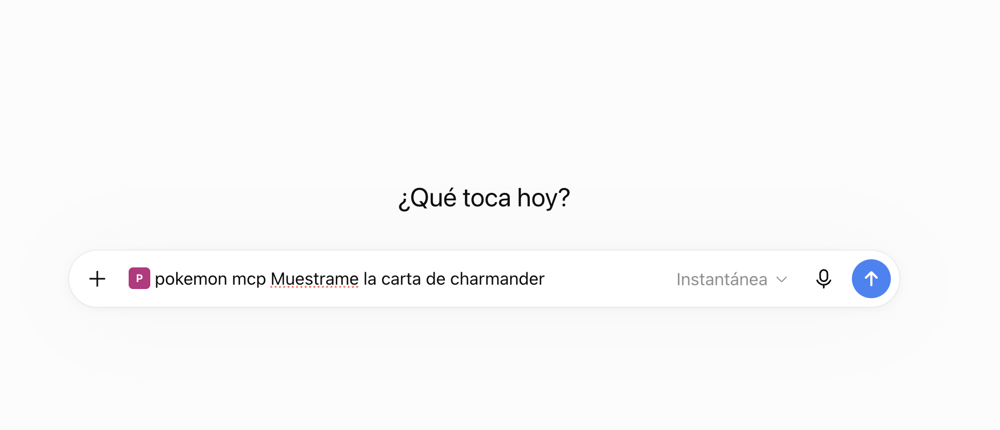
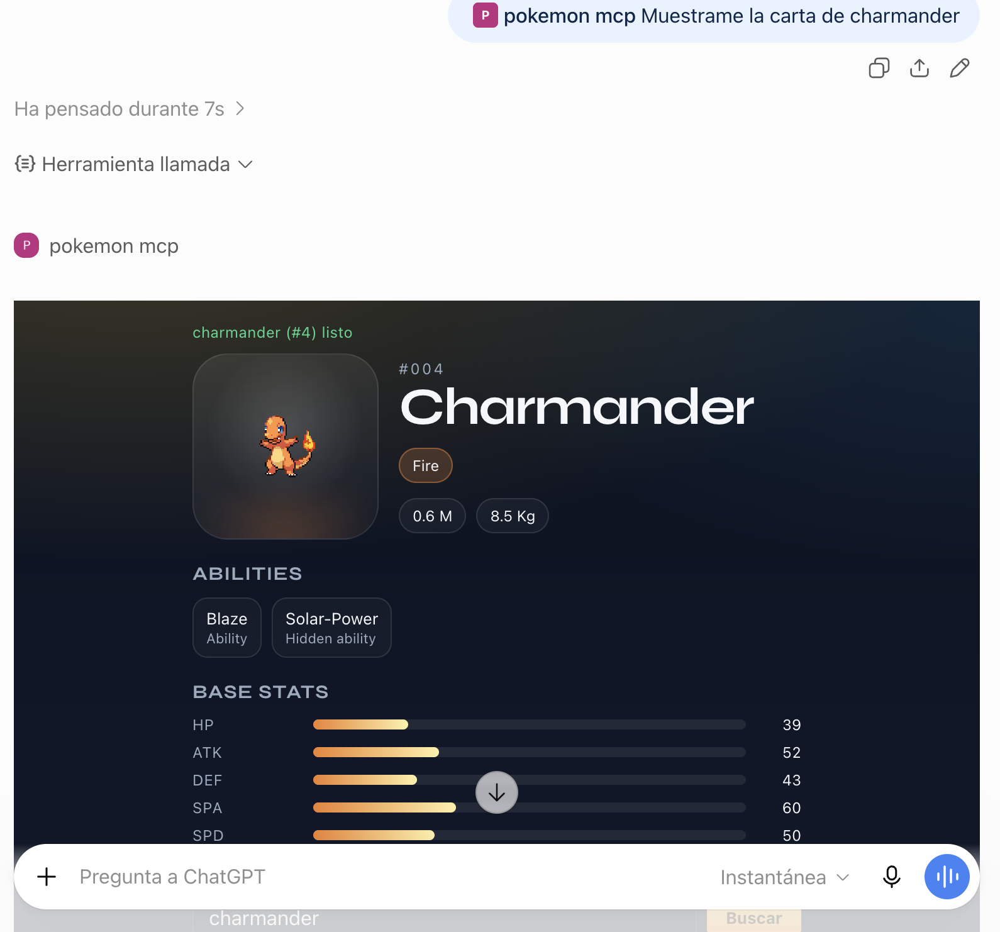

# Pokémon MCP

MCP server de ejemplo que expone [PokéAPI](https://pokeapi.co/) como tools de ChatGPT y Cursor, con un widget visual embebido (MCP Apps) y eventos que avisan a ChatGPT (MCP Events).

Implementa el flujo recomendado por OpenAI: primero [tools](https://developers.openai.com/plugins/build/mcp-server), después [UI](https://developers.openai.com/plugins/build/chatgpt-ui).

## Demo

Conector activo en ChatGPT y petición al modelo:



Respuesta con la tarjeta visual generada por `render_pokemon_widget`:



## Características

- **Tools read-only** contra PokéAPI (`list_pokemon`, `get_pokemon`, `get_type`)
- **Patrón desacoplado**: tools de datos + tool de render con `_meta.ui.resourceUri`
- **Widget inline** con sprite, tipos, habilidades, stats y matchups
- **Dos transports**: stdio (Cursor) y Streamable HTTP `/mcp` (ChatGPT / Inspector)
- **Preview local** en `/preview` sin depender del host
- **MCP Events**: evento `pokemon.appeared` que ChatGPT puede vigilar (webhooks firmados)

## Requisitos

- Node.js 18+
- npm

## Inicio rápido

```bash
git clone git@github.com:omy13/mcp-ui-openai-pokemon.git
cd mcp-ui-openai-pokemon

npm install
npm --prefix web install
npm run build:web   # obligatorio antes de arrancar el server
npm run dev:http
```

Comprueba el widget en http://localhost:8787/preview y el endpoint MCP en http://localhost:8787/mcp.

> **Importante:** tras clonar el repo, ejecuta siempre `npm run build:web`. El server embebe `web/dist/widget.js` en el resource HTML; sin ese build, `dev:http` fallará.

## Tools

| Tool | Descripción | UI |
|------|-------------|----|
| `list_pokemon` | Lista Pokémon paginados (`limit`, `offset`) | No |
| `get_pokemon` | Detalle por nombre o id (`pikachu`, `25`) | No |
| `get_type` | Matchups y Pokémon de un tipo | No |
| `render_pokemon_widget` | Renderiza la tarjeta visual | Sí |

Flujo recomendado en ChatGPT:

1. El modelo llama `get_pokemon` y obtiene `structuredContent`.
2. Luego llama `render_pokemon_widget` con esos campos.
3. ChatGPT monta el iframe con el resource `ui://widget/pokemon-card.html`.

## MCP Events

El server anuncia la capacidad `events` y expone un evento:

| Evento | Filtro | Payload |
|--------|--------|---------|
| `pokemon.appeared` | `type` opcional (`fire`, `water`…) | `id`, `name`, `types`, `spriteUrl` |

Flujo:

1. ChatGPT llama `events/list` y ve `pokemon.appeared`.
2. El usuario pide, por ejemplo: *Avísame cuando aparezca un Pokémon de tipo fuego y dime contra qué tipos es fuerte*.
3. ChatGPT llama `events/subscribe` con una URL de callback y una clave `whsec_…`.
4. El server verifica el callback con un reto firmado y guarda la suscripción en `data/subscriptions.json`.
5. `POST /dev/wild-pokemon` simula que aparece un Pokémon y el server manda el evento firmado ([Standard Webhooks](https://github.com/standard-webhooks/standard-webhooks)) a cada suscripción que encaje.

Seguridad: callbacks solo HTTPS, sin redirecciones, y la IP se valida al conectar (se bloquean direcciones privadas y locales).

> MCP Events es un borrador de extensión. En ChatGPT funciona en chats de trabajo (web, y escritorio con **Cloud**) y con dots. Esta demo no tiene autenticación: todas las suscripciones son del mismo usuario.

Docs: [MCP Events — OpenAI](https://developers.openai.com/plugins/build/mcp-events)

### Probar en local (sin ChatGPT)

`events:receiver` hace de ChatGPT: levanta un receptor en `:9000`, se suscribe y verifica las firmas.

```bash
# Terminal 1: server MCP (permite callbacks http://localhost solo para esta prueba)
DEV_TRIGGER_TOKEN=secreto EVENTS_ALLOW_INSECURE_LOCALHOST=true npm run dev:http

# Terminal 2: receptor suscrito a Pokémon de tipo fuego
npm run events:receiver -- fire

# Terminal 3: aparece un Charmander
curl -X POST 'http://localhost:8787/dev/wild-pokemon?name=charmander' \
  -H 'Authorization: Bearer secreto'
```

Sin `?name=` aparece un Pokémon aleatorio de la primera generación. Sin `DEV_TRIGGER_TOKEN`, `/dev/wild-pokemon` responde 404.

### Probar en ChatGPT

1. Arranca con `DEV_TRIGGER_TOKEN=secreto npm run dev:http` y expón el puerto con un túnel HTTPS (ver abajo).
2. Conecta el server como plugin y vuelve a escanearlo: `pokemon.appeared` aparece junto a las tools.
3. En un chat de trabajo pide que vigile un tipo y qué hacer cuando llegue un evento.
4. Dispara `POST https://TU-TUNEL/dev/wild-pokemon?name=charmander` con el token.

## Desarrollo

### Preview del widget (sin ChatGPT)

```bash
npm run build:web
npm run dev:http
```

| URL | Descripción |
|-----|-------------|
| http://localhost:8787/preview | Pikachu mock |
| http://localhost:8787/preview/live | Datos reales de PokéAPI |

### Cursor (stdio)

```bash
npm run build:web
npm run dev
```

Configuración MCP (sustituye `PATH_TO_REPO` por la ruta absoluta del proyecto):

```json
{
  "mcpServers": {
    "pokemon-mcp": {
      "command": "node",
      "args": [
        "./node_modules/tsx/dist/cli.mjs",
        "src/index.ts"
      ],
      "cwd": "PATH_TO_REPO"
    }
  }
}
```

Si Cursor no encuentra `node` (común con nvm), usa la ruta absoluta del binario en `command`.

### ChatGPT (developer mode)

1. Arranca el server: `npm run build:web && npm run dev:http`
2. Expón el puerto con un túnel HTTPS, por ejemplo: `ngrok http 8787`
3. En ChatGPT: **Settings → Apps & Connectors → Advanced → Developer mode**
4. Crea un connector apuntando a `https://TU-TUNEL.ngrok.app/mcp`
5. En un chat nuevo, activa el connector y prueba: *Muestrame la carta de charmander*

Docs: [Connect from ChatGPT](https://developers.openai.com/plugins/deploy/connect-chatgpt)

### MCP Inspector

```bash
npx @modelcontextprotocol/inspector@latest \
  --server-url http://localhost:8787/mcp \
  --transport http
```

### Smoke test

```bash
npm run smoke
```

## Scripts

| Comando | Descripción |
|---------|-------------|
| `npm run dev` | MCP por stdio (Cursor) |
| `npm run dev:http` | MCP HTTP en `:8787/mcp` |
| `npm run build:web` | Compila el widget (`web/dist/widget.js`) |
| `npm run build` | Widget + TypeScript → `dist/` |
| `npm run smoke` | Prueba rápida del cliente PokéAPI |
| `npm run events:receiver` | Receptor local de MCP Events (hace de ChatGPT) |

## Estructura del proyecto

```text
pokemon-mcp/
├── src/
│   ├── pokeapi-client.ts    # Cliente HTTP a PokéAPI
│   ├── server.ts            # McpServer + tools + resource
│   ├── events.ts            # MCP Events: events/list, subscribe, unsubscribe y envío
│   ├── event-subscriptions.ts # Suscripciones guardadas en JSON
│   ├── webhook-delivery.ts  # POST firmado + bloqueo de IPs privadas
│   ├── dev-event-receiver.ts # Receptor local para probar eventos
│   ├── widget-resource.ts   # HTML embebido del widget
│   ├── preview-widget.ts    # Datos mock para /preview
│   ├── http.ts              # Transport HTTP + preview
│   └── index.ts             # Transport stdio
├── web/
│   ├── src/                 # Widget (TypeScript + CSS)
│   └── dist/widget.js       # Bundle generado (no versionado)
└── images/                  # Capturas para documentación
```

## Variables de entorno

Copia `.env.example` si necesitas overrides:

```bash
POKEAPI_BASE_URL=https://pokeapi.co/api/v2
PORT=8787
DEV_TRIGGER_TOKEN=                          # activa POST /dev/wild-pokemon
EVENTS_STORE_PATH=data/subscriptions.json
EVENTS_ALLOW_INSECURE_LOCALHOST=false       # true solo para events:receiver
```

## Referencias

- [PokéAPI](https://pokeapi.co/)
- [Build an MCP server — OpenAI](https://developers.openai.com/plugins/build/mcp-server)
- [Add UI to your MCP server — OpenAI](https://developers.openai.com/plugins/build/chatgpt-ui)
- [MCP Inspector](https://modelcontextprotocol.io/docs/tools/inspector)
- [MCP Events — OpenAI](https://developers.openai.com/plugins/build/mcp-events)
- [Standard Webhooks](https://github.com/standard-webhooks/standard-webhooks)

## Licencia

MIT — úsalo como base para tus propios MCP servers.
